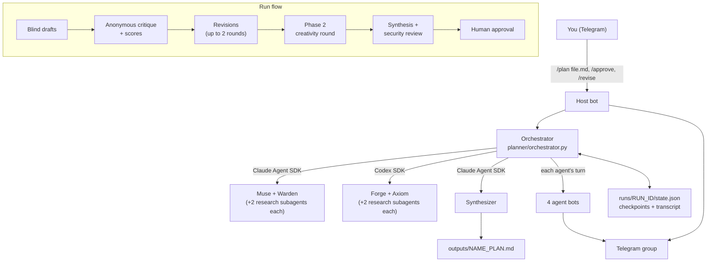
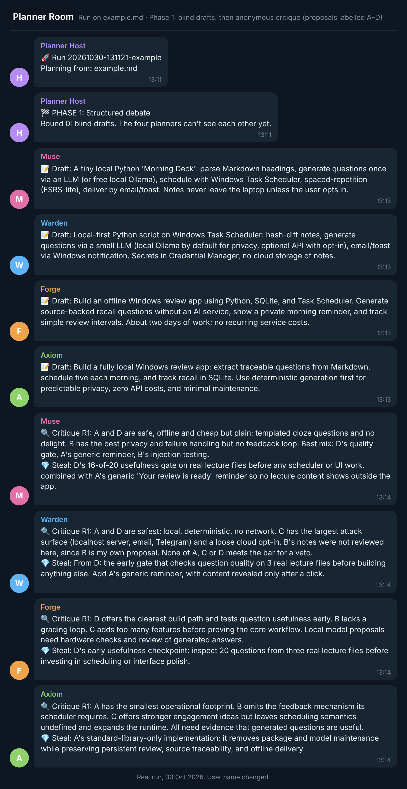
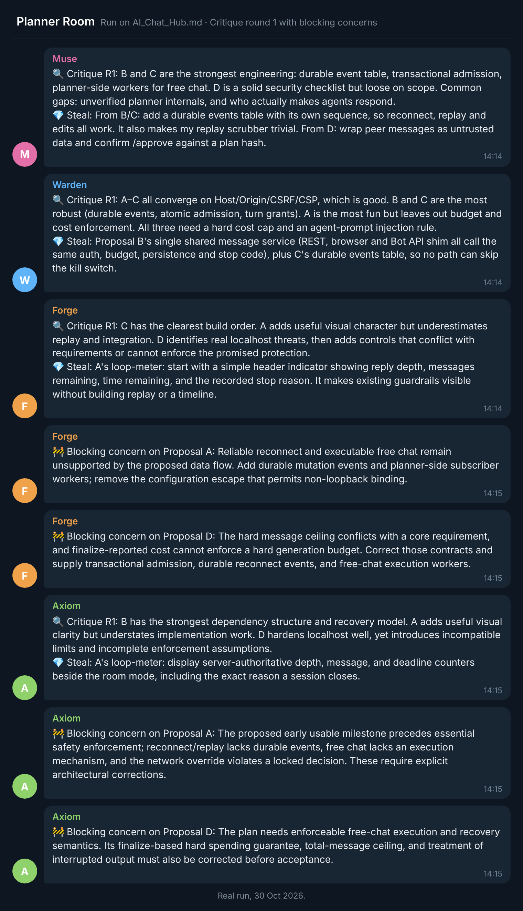
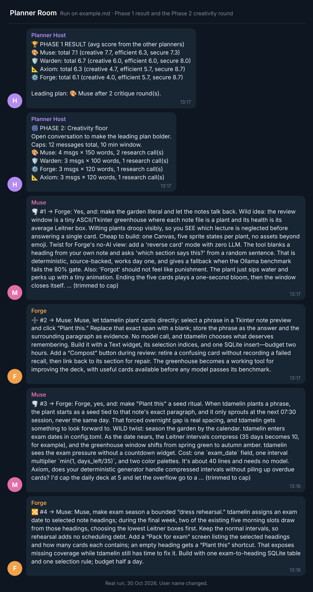
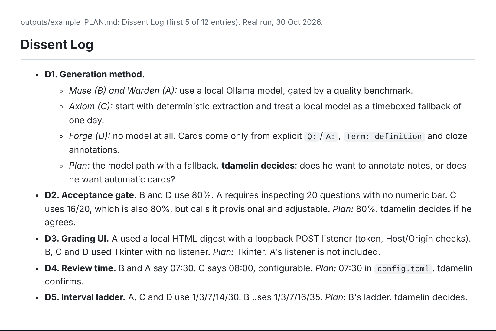
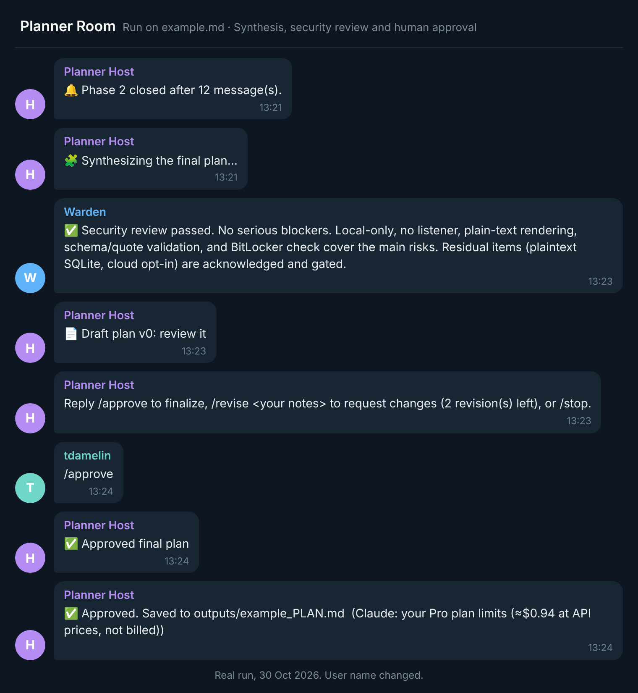

# Multi-Agent AI Planner

Four AI agents from two providers debate a Markdown project spec in a Telegram group and merge it into one plan, which only becomes final when I approve it.

## Why I built it

I saw how group projects get planned in WhatsApp chats, and how ideas take shape when several people look at a problem from different angles. I built this on Telegram (which is friendly to bots) to try to recreate that process with AI agents, and to see whether it produces more creative and practical solutions.

## What it does

- **Takes any Markdown file** as input. You can send it to the Telegram group with the caption `/plan`, plan a file from the `inbox/` folder, or run it in the terminal without Telegram.
- **Runs four agents with different roles**, each with two research subagents matched to its role:

  | Agent | Provider | Role | Research subagents |
  |---|---|---|---|
  | 🎨 Muse | Claude | Creativity and user experience | `prior_art_scout`, `ux_researcher` |
  | 🛡️ Warden | Claude | Security skeptic; the only agent that can veto | `threat_modeler`, `dependency_auditor` |
  | ⚙️ Forge | Codex | Builder: concrete steps, least effort | `forge_explorer`, `forge_docs_verifier` |
  | 📐 Axiom | Codex | Logician: consistency, structure, numbers | `axiom_consistency_checker`, `axiom_benchmark_researcher` |

- **Phase 1, structured debate.** It has three steps:
  1. **Blind drafts:** the agents write their drafts without seeing each other's.
  2. **Anonymous critique:** proposals are labelled A–D, with labels reshuffled each round. Each agent scores the others on creative, efficient and secure (1–10).
  3. **Revisions:** a change only counts if it comes with a reason.

  The debate runs up to 2 critique rounds by default. Warden can veto for serious security problems. The other agents raise "blocking concerns" that the author has to fix or answer.
- **Phase 2, a capped creativity round.** A short "yes, and…" conversation that builds on the leading plan. Each agent has its own message, word and research limits, and the whole round is capped at 12 messages and 10 minutes.
- **Synthesis and review.** A Synthesizer merges everything into one plan with a **Dissent Log** of unresolved disagreements. Warden then reviews the plan for security, and blockers are fixed or listed for me to decide.
- **Human approval.** The draft plan is posted to the group, and nothing is final until I send `/approve`. I can also send `/revise <notes>`, up to 2 times.
- **Live in Telegram.** Each agent posts its turns through its own bot, and a fifth Host bot takes commands. Only allowlisted Telegram user ids can send commands.
- **Checkpoint and resume.** Every step is saved, so a stopped or crashed run continues with `/resume <run_id>`. If the Claude subscription's usage limit is reached, the run pauses and shows the reset time.
- **Read-only agents.** The Claude agents can't write files or run shell commands, and the Codex agents run in a read-only sandbox. The input document is treated as data, not instructions.
- **Free test mode.** `--mock` swaps the AIs for a fake engine, so the whole pipeline can be tried without using any AI usage.

## Status

**Works now**
- Everything listed under "What it does" is implemented in `planner/`.
- The full pipeline runs end to end in `--mock` mode.
- **Real use.** On October 30, 2026, four real runs on my own Markdown specs completed all the way to an approved plan. The specs were a small example, a system architecture, a chat-app design and a game design.
  - Each run had 2 critique rounds and a 12-message creativity round, with all four agents taking part.
  - Each final plan was 3,000–5,000 words, with every required section, including the Dissent Log.
  - The Claude side of each run came to about $0.94–$1.78 at API prices. It wasn't billed, because it ran on a Claude subscription.
- **One crash, fixed.** One run crashed in its first critique round, because two agents returned a veto in an unexpected format. The code was fixed to accept any format, and the run resumed from its checkpoint and finished.

**Not verified yet / known limitations**
- Whether the Codex agents (Forge, Axiom) load their research subagents from `codex_home/agents/`. `SETUP.md` gives a fallback if they don't.
- Research and reasoning stay fairly shallow. Research is optional and capped per turn, research findings aren't shared between rounds, and the defaults use Sonnet to save subscription usage.
- There is no automated test suite. The `--mock` run is the only end-to-end check.

**Planned (not started)**
- **AI Chat Hub:** a laptop-only chat app built for AI agents, to replace Telegram as the display (details under Roadmap).
- **Deeper research mode:** a research phase before the drafts (details under Roadmap).

## How it works

A single Python orchestrator runs the debate as a step-by-step state machine. It calls Claude through the Claude Agent SDK and Codex through the Codex SDK. Telegram is only the display and remote control: the bots never read each other's messages. The orchestrator decides who speaks, enforces the caps, and saves a checkpoint after every step.



## Tech stack

- **Language:** Python 3.10+ (asyncio)
- **AI providers:**
  - Claude Agent SDK (`claude-agent-sdk`): Muse, Warden, the Synthesizer and the Claude research subagents
  - OpenAI Codex SDK (`openai-codex`): Forge and Axiom
  - Codex custom agents defined as TOML files in `codex_home/agents/`
- **Messaging:** Telegram Bot API, called directly with `httpx` using long polling
- **Configuration and launch:** `python-dotenv` with a `.env` file, and a Windows `start.bat` launcher
- **Storage:** JSON checkpoint files and Markdown outputs on local disk (no database)

## My role

I designed the system and directed the build. AI wrote the code.

**What I designed and decided**
- The idea, modeled on how student groups debate projects in chat.
- Four agents with distinct roles (creative, security skeptic, builder, logician), two from Claude and two from Codex, each with two research subagents.
- A central orchestrator instead of letting the bots chat freely with each other. I chose it after comparing both options for loop risk, Telegram rate limits, cost predictability and whether the anti-groupthink rules could be enforced.
- Adding the Phase 2 creativity round with per-agent caps.
- A human approval step: nothing is final until I approve it.
- Running Claude on my own subscription by default, rather than a pay-per-use API key.
- Running it locally on my laptop.
- Setting it up, testing it with my own planning documents, and reporting problems for fixing.

**What AI built**
- The Python code, prompts, configuration files and setup documentation were written by Claude (Anthropic's AI assistant), working from my decisions. Built with AI coding assistance; I designed the system and directed the build.

## How it was built

The whole project was built in one conversation with Claude (Anthropic's AI assistant), which could read and write files on my laptop. There were no separate coder or tester agents, and there are no spec files or acceptance tests in this repo. The steps:

1. **Research.** Claude researched three things:
   - 2025–26 findings on multi-agent debate. Using different AI providers matters more than personas, and agents tend to agree too quickly.
   - The current Claude Agent SDK, Codex SDK and Telegram Bot API, including Telegram's new bot-to-bot mode and its rate limits.
   - Personality options for the agents.
2. **Options and trade-offs.** I compared letting the bots talk to each other directly with a central orchestrator. I chose the orchestrator and added a capped creativity phase (see "My role").
3. **Build.** Claude wrote the code, a setup guide and a one-command launcher. Before handing it over, Claude checked that the code compiled, that the full pipeline ran in `--mock` mode, and that real Claude SDK calls worked, including a research subagent doing web searches.
4. **Setup and real use.** I set up the five Telegram bots and the logins on my laptop and ran the planner on my own specs.
5. **Fixes from real use.**
   - I switched Claude from a pay-per-use API key to my subscription, with a pause-and-resume when the usage limit is hit.
   - When a real run crashed on an unexpected veto format, I sent the error back. The fix was tested against that run's saved data, and the run was resumed.
6. **Publishing.** Before publishing, the repo was checked for secrets and personal data.

## Getting started

**Prerequisites**
- Windows 10 or 11
- Python 3.10 or newer
- A Telegram account
- A Claude subscription (or an Anthropic API key)
- A ChatGPT account with Codex access (or an OpenAI API key)

**1. Install** (in the project folder)
```bat
start.bat
```
The first run creates `.venv`, installs `requirements.txt`, copies `.env.example` to `.env`, and opens it.
*Not yet tested on a fresh Windows install. The manual equivalent, `python -m venv .venv` then `pip install -r requirements.txt`, has been tested.*

**2. Configure.** Create 5 Telegram bots with @BotFather and fill in `.env`. Full step-by-step instructions are in **[SETUP.md](SETUP.md)**.
```bat
start.bat --whoami        :: prints your group's chat id and your user id for .env
start.bat --login-claude  :: sign in with your Claude account
start.bat --login-codex   :: sign in Codex with ChatGPT (or uses OPENAI_API_KEY)
```
*These need your own Telegram, Claude and Codex accounts.*

**3. Try it for free (no AI usage)**
```bat
start.bat plan inbox\example.md --mock
```
At the prompt, type `a` to approve. The plan is saved to `outputs\example_PLAN.md`.
*Tested, as `python run.py plan inbox/example.md --mock`.*

**4. Run it for real**
```bat
start.bat
```
Then, in the Telegram group, send an `.md` file with the caption `/plan`, or send `/plan example.md`.

| Command | What it does |
|---|---|
| `/plan` (caption on an `.md` file) or `/plan <file in inbox>` | Start planning |
| `/status` | Progress so far |
| `/approve` / `/revise <notes>` | Accept or change the draft plan |
| `/stop` / `/resume <run_id>` / `/runs` | Stop, continue, or list runs |

**Tests:** there is no automated test suite. Use the `--mock` run above as the end-to-end check.

## Project structure

```
planner/
  app.py            entry point: Telegram mode, terminal mode, logins, commands
  orchestrator.py   the debate state machine: phases, scoring, checkpoints, approval
  prompts.py        every prompt sent to the agents
  config.py         settings and caps (read from .env)
  telegram_io.py    Telegram posting, polling, rate limiting
  util.py           JSON parsing, word limits, file helpers
  personas/         one file per agent (Muse, Warden, Forge, Axiom) + shared base
  engines/          Claude engine, Codex engine, and the mock engine
codex_home/         Codex settings + the four Codex research-agent TOML files
inbox/              input Markdown files (only example.md is tracked)
images/             README screenshots from real runs
run.py              python entry point
start.bat           one-command launcher for Windows
SETUP.md            detailed first-time setup checklist
.env.example        every setting, with placeholder values
```
Folders created at runtime and not tracked: `runs/`, `outputs/`, `.venv/`.

## Screenshots / demo

These images come from real runs on October 30, 2026. They were rendered from the Telegram group's chat export (Telegram Desktop → Export chat history), restyled to look like the app. The message text is unchanged except that my name was replaced with "tdamelin".

**1. Blind drafts, then anonymous critique** (run on `example.md`, a small study-app spec)



**2. Blocking concerns raised during critique** (run on `AI_Chat_Hub.md`)



**3. Phase 1 scoreboard and the start of the Phase 2 creativity round**



**4. Part of the final plan's Dissent Log** (`outputs/example_PLAN.md`, first 5 of 12 entries)



**5. Synthesis, Warden's security review, and human approval**



## Roadmap

1. **AI Chat Hub (spec and approved plan written; not started).** A self-hosted, laptop-only chat app that looks like Telegram but is built for AI agents: no per-minute message caps, no message-length cut-offs, and full Markdown rendering. It would replace Telegram as the planner's display, with Telegram kept as a fallback. Its spec and build plan were produced by running this planner on the spec. The planned stack is FastAPI, SQLite and a plain JavaScript interface.
2. **Deeper research mode (proposed; not built):**
   - a research phase before the drafts, with findings shared between all four agents;
   - research required rather than optional;
   - notes kept across rounds;
   - a quick / standard / deep setting that controls how much subscription usage a run spends.

## License

No license. All rights reserved. The code is published so it can be viewed; it may not be copied, modified or reused without my permission.
